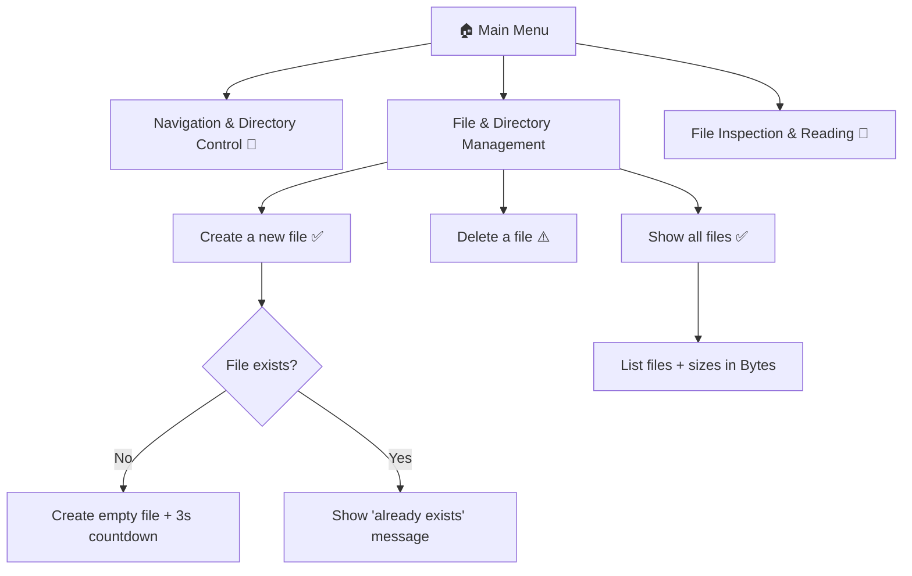

# 📁 File Management System


-lightgrey)

A simple, menu-driven **command-line tool** for managing files in your current working directory. Navigate the menu with the arrow keys, press Enter to select, and let the program handle the rest.

> **Status:** v1.0 is an early release. Some menu items are placeholders for future versions (see [Roadmap](#-roadmap)).

---

## ✨ Features (v1.0)

| Feature | Menu Path | Status |
|---|---|---|
| Create a new (empty) file | File & Directory Management → Create a new file | ✅ Working |
| List all files with their sizes | File & Directory Management → Show all files | ✅ Working |
| Delete a file (with Y/N confirmation) | File & Directory Management → Delete a file | ⚠️ Known bug (see below) |
| Navigation & Directory Control | Main menu | 🚧 Not implemented yet |
| File Inspection & Reading | Main menu | 🚧 Not implemented yet |

---

## 🗺️ Menu Structure



---

## 🔧 Requirements

- **Python 3.10 or newer** (the code uses `match` / `case`, introduced in Python 3.10)
- The [`pick`](https://pypi.org/project/pick/) library for the arrow-key menus
- **Windows** is recommended in v1.0 (see [Platform Notes](#-platform-notes))

---

## 🚀 Installation & Usage

**1. Clone or download the project**

```bash
git clone https://github.com/KhunSama/File-Management.git
cd File Management
```

**2. (Optional) Create a virtual environment**

```bash
python -m venv venv

# Windows
venv\Scripts\activate

# macOS / Linux
source venv/bin/activate
```

**3. Install the dependency**

```bash
pip install pick
```

**4. Run the program** (replace `main.py` with your file name)

```bash
python main.py
```

> 💡 The program works on the **directory you run it from** (`os.getcwd()`). Run it inside the folder you want to manage.

---

## 🎮 Controls

| Key | Action |
|---|---|
| ↑ / ↓ | Move the `=>` indicator |
| Enter | Select the highlighted option |
| Any key | Continue / go back (on screens that say "Press any button") |

---

## 🧠 How It Works

```
┌────────────────────────────────────────────┐
│  while True  (main loop)                   │
│   ├─ pick()  → show main menu              │
│   └─ match   → run chosen option           │
│        └─ while True  (sub-menu loop)      │
│             ├─ pick()  → show sub-menu     │
│             └─ match   → run chosen action │
└────────────────────────────────────────────┘
```

**Helper functions**

| Function | What it does |
|---|---|
| `timer(seconds)` | Prints a live `MM:SS` countdown ("Redirecting in 00:03") before returning |
| `press_any_key()` | Pauses until a key is pressed (uses `msvcrt`, Windows only) |
| `clear_screen()` | Clears the terminal (`cls` on Windows, `clear` on macOS/Linux) |

**Concepts used** (good to know if you're learning from this code):
`while` loops · `match`/`case` · f-strings · file I/O (`open`, `os.remove`) · the `os` module (`getcwd`, `listdir`, `path.exists`, `path.isfile`, `path.getsize`) · third-party libraries (`pick`)

---

## 🖥️ Platform Notes

- `press_any_key()` only waits for input on **Windows**. On macOS/Linux it returns immediately, so messages may disappear too quickly.
- The `pick` library uses `curses`. On Windows, `pick` pulls in `windows-curses` automatically; if the menu doesn't render, run `pip install windows-curses`.

---

## 🐛 Known Issues (v1.0)

1. **"Delete a file" does nothing.** The menu label is `"Delete a file"`, but the code matches `case "Delete file"`, so the strings never match. *Fix: make both strings identical.*
2. **No way to go back** from the *File & Directory Management* sub-menu. The inner `while True` loop has no exit option.
3. **Delete loop never exits after a successful delete** — it asks for another file name again.
4. **Main-menu options 1 and 3** (*Navigation & Directory Control*, *File Inspection & Reading*) have no `case` yet, so selecting them just reloads the menu.
5. **Current directory display is static.** `CurPath` is set once at startup and never updated.
6. `show all files` calls `os.path.getsize(v)` with a relative path, which breaks if the working directory ever changes.
7. Stray semicolons (`;`) throughout the code are valid but unnecessary in Python.

---

## 🛣️ Roadmap

- [ ] Fix the "Delete a file" bug
- [ ] Add a **Back** / **Exit** option to every menu
- [ ] **Navigation & Directory Control:** change directory, go up a level, show current path
- [ ] **File Inspection & Reading:** view file contents, file info (size, modified date)
- [ ] Create / delete **directories**
- [ ] Cross-platform `press_any_key()`
- [ ] Error handling with `try` / `except` (permissions, invalid names)
- [ ] Split the code into functions / modules

---

## 📝 Changelog

### v1.0
- Initial release
- Interactive arrow-key menu using `pick`
- Create a new file
- List files with sizes
- Delete-file flow (contains a known bug)

---