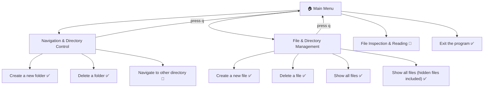
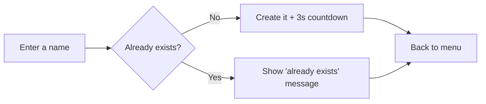
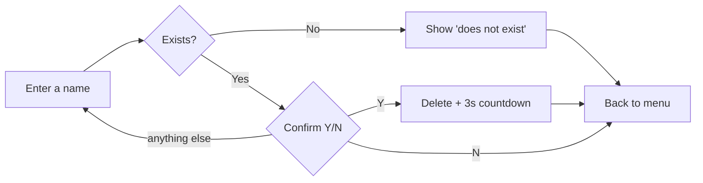

# 📁 File Management System


-lightgrey)

A simple, menu-driven **command-line tool** for managing files and folders in your current working directory. Navigate the menus with the arrow keys, press Enter to select, and press `q` to go back.

> **Status:** v1.2 is an early release. Two features are still placeholders (see [Roadmap](#-roadmap)).

---

## ✨ Features (v1.2)

| Feature | Menu Path | Status |
|---|---|---|
| Create a new (empty) file | File & Directory Management → Create a new file | ✅ Working |
| Delete a file (with Y/N confirmation) | File & Directory Management → Delete a file | ✅ Working |
| List all files with their sizes | File & Directory Management → Show all files | ✅ Working |
| List everything (files and folders) with sizes | File & Directory Management → Show all files (hidden files included) | ✅ Working |
| Create a new folder | Navigation & Directory Control → Create a new folder | ✅ Working |
| Delete an **empty** folder (with Y/N confirmation) | Navigation & Directory Control → Delete a folder | ✅ Working (empty folders only) |
| Change to another directory | Navigation & Directory Control → Navigate to other directory | 🚧 Not implemented yet |
| File Inspection & Reading | Main menu | 🚧 Shows "Currently unavailable" |
| Go back with `q` | Sub-menus | ✅ Working |
| Exit the program | Main menu → Exit the program | ✅ Working |

---

## 🗺️ Menu Structure



### Create flow (file or folder)



### Delete flow (file or folder)



---

## 🔧 Requirements

- **Windows** (the program imports `msvcrt`, which only exists on Windows)
- **Python 3.10 or newer** (the code uses `match` / `case`, introduced in Python 3.10)
- The [`pick`](https://pypi.org/project/pick/) library (version 2.x) for the arrow-key menus

---

## 🚀 Installation & Usage

**1. Clone or download the project**

```bash
git clone https://github.com/KhunSama/File-Management.git 
```

**2. (Optional) Create a virtual environment**

```bash
python -m venv venv
venv\Scripts\activate
```

**3. Install the dependency**

```bash
pip install pick
```

**4. Run the program** (replace `main.py` with your file name)

```bash
python main.py
```

> 💡 The program works on the **directory you run it from** (`os.getcwd()`). Run it inside the folder you want to manage.

---

## 🎮 Controls

| Key | Action |
|---|---|
| ↑ / ↓ | Move the `=>` indicator |
| Enter | Select the highlighted option |
| `q` | Go back to the previous menu |
| Any key | Continue (on screens that say "Press any key") |
| `Y` / `N` + Enter | Confirm or cancel a delete |

---

## 🧠 How It Works

The code is split into small functions, and the menus call each other like this:

```
mainMenu()
 ├─ showMenu()  → arrow-key menu (wraps pick's Picker, adds the 'q' handler)
 ├─ match option
 │    ├─ "Navigation & Directory Control" → folderSubMenu()
 │    │      └─ match option → create folder / delete folder / navigate (🚧)
 │    ├─ "File & Directory Management"    → fileSubMenu()
 │    │      └─ match option → create / delete / list / list-all
 │    ├─ "File Inspection & Reading"      → "Currently unavailable" 🚧
 │    └─ "Exit the program"               → sys.exit()
 └─ loops until you exit        ('q' inside a sub-menu returns here)
```

**Functions**

| Function | What it does |
|---|---|
| `showMenu(options, title, ...)` | Shows an arrow-key menu and registers `q` as a "go back" key (returns index `-1`) |
| `timer(seconds)` | Prints a live `MM:SS` countdown ("Redirecting in 00:03") |
| `press_any_key()` | Pauses until a key is pressed (uses `msvcrt.getch()`) |
| `clear_screen()` | Clears the terminal (`cls` on Windows, `clear` elsewhere) |
| `folderSubMenu()` | "Navigation & Directory Control" menu: create folder, delete folder, navigate (🚧) |
| `fileSubMenu()` | "File & Directory Management" menu: create file, delete file, list files |
| `mainMenu()` | The top-level menu loop |

**Concepts used** (useful if you're learning from this code):
functions · `while` loops · `match`/`case` · f-strings · file I/O (`open`, `os.remove`) · the `os` module (`getcwd`, `listdir`, `mkdir`, `rmdir`, `path.exists`, `path.isfile`, `path.getsize`) · `sys.exit` · nested functions and custom key handlers · third-party libraries (`pick`)

---

## 🐛 Known Issues (v1.2)

1. **Windows only.** `import msvcrt` sits at the top of the file, so the program crashes on startup on macOS/Linux with an `ImportError`. *Fix: import `msvcrt` inside `press_any_key()` (only when `os.name == 'nt'`).*
2. **"Navigate to other directory" is an empty placeholder.** Selecting it does nothing and just redraws the menu.
3. **Delete a folder only works on empty folders.** `os.rmdir()` raises an error on a folder with contents, and the program crashes (no `try` / `except`). *Fix: catch `OSError`, or use `shutil.rmtree()` with an extra warning.*
4. **Wrong type of name crashes the delete.** Typing a *file* name into "Delete a folder" (or a *folder* name into "Delete a file") raises an error, because `os.path.exists()` is true for both.
5. **Delete confirmation re-prompts silently.** Any answer other than `y` or `n` sends you back to the "File name / Folder name" prompt with no "Invalid" message.
6. **"Show all files (hidden files included)" is misleadingly named.** `os.listdir()` already returns hidden files, so the real difference is that this option also lists *folders*. Consider renaming it to "Show all files and folders".
7. **`q` on the main menu does nothing** (it just redraws the menu), but the title still says "Press 'q' to return to previous menu".
8. **Current directory display is static.** `CurPath` is set once at startup and never updated, which will matter as soon as "Navigate" is implemented.
9. **File sizes use a relative path.** `os.path.getsize(v)` breaks if the working directory ever changes. Use `os.path.join(CurPath, v)` instead.
10. **Numbering gaps in "Show all files".** The number comes from `enumerate` over *all* entries, so skipped folders leave gaps (e.g. 1, 3, 4).
11. **Small text typos:** "The folder is already exists." and "Every files inside this directory".
12. Stray semicolons (`;`) throughout the code are valid but unnecessary in Python.

---

## 🛣️ Roadmap

- [x] Fix the "Delete a file" menu bug *(v1.1)*
- [x] Add a back option (`q`) and an Exit option *(v1.1)*
- [x] Split the code into functions *(v1.1)*
- [x] Delete flow returns to the menu after finishing *(v1.2)*
- [x] Create / delete folders *(v1.2)*
- [x] Option to list all entries, including folders *(v1.2)*
- [ ] Implement **Navigate to other directory** (and update `CurPath`)
- [ ] **File Inspection & Reading:** view file contents, file info (size, modified date)
- [ ] Handle non-empty folders and wrong-type names when deleting
- [ ] Cross-platform `press_any_key()`
- [ ] Error handling with `try` / `except`
- [ ] Reduce repeated code (create/delete logic is nearly identical for files and folders)

---

## 📝 Changelog

### v1.2
- Added the **Navigation & Directory Control** sub-menu (`folderSubMenu`)
  - Create a new folder
  - Delete a folder (empty folders only)
  - Navigate to other directory (placeholder, not implemented yet)
- Added "Show all files (hidden files included)" to the file menu
- Delete flows (file and folder) now return to the menu after finishing, with a 3-second countdown after a successful delete
- Typing `n` at the delete confirmation now cancels and returns to the menu

### v1.1
- Refactored into functions (`showMenu`, `fileSubMenu`, `mainMenu`, ...)
- Added `q` key to go back from sub-menus
- Added "Exit the program" option
- Fixed the "Delete a file" option (menu text and `case` now match)
- Unfinished options now show "Currently unavailable" instead of silently reloading
- `msvcrt` is now imported at the top, making the program Windows-only

### v1.0
- Initial release
- Interactive arrow-key menu using `pick`
- Create a new file
- List files with sizes
- Delete-file flow (contained a bug)

---