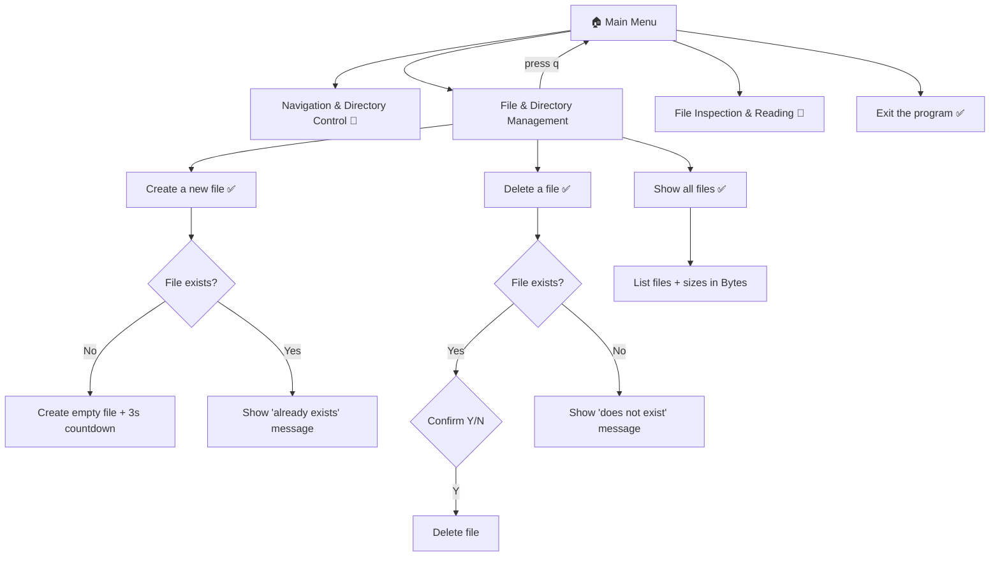

# 📁 File Management System


-lightgrey)

A simple, menu-driven **command-line tool** for managing files in your current working directory. Navigate the menus with the arrow keys, press Enter to select, and press `q` to go back.

> **Status:** v1.1 is an early release. Two main-menu items are still placeholders (see [Roadmap](#-roadmap)).

---

## ✨ Features (v1.1)

| Feature | Menu Path | Status |
|---|---|---|
| Create a new (empty) file | File & Directory Management → Create a new file | ✅ Working |
| Delete a file (with Y/N confirmation) | File & Directory Management → Delete a file | ✅ Working (see [Known Issues](#-known-issues-v11)) |
| List all files with their sizes | File & Directory Management → Show all files | ✅ Working |
| Go back with `q` | Sub-menus | ✅ Working |
| Exit the program | Main menu → Exit the program | ✅ Working |
| Navigation & Directory Control | Main menu | 🚧 Shows "Currently unavailable" |
| File Inspection & Reading | Main menu | 🚧 Shows "Currently unavailable" |

---

## 🗺️ Menu Structure



---

## 🔧 Requirements

- **Windows** (the program imports `msvcrt`, which only exists on Windows)
- **Python 3.10 or newer** (the code uses `match` / `case`, introduced in Python 3.10)
- The [`pick`](https://pypi.org/project/pick/) library (version 2.x) for the arrow-key menus

---

## 🚀 Installation & Usage

**1. Clone or download the project**

```bash
git clone <your-repo-url>
cd <your-project-folder>
```

**2. (Optional) Create a virtual environment**

```bash
python -m venv venv
venv\Scripts\activate
```

**3. Install the dependency**

```bash
pip install pick
```

**4. Run the program** (replace `main.py` with your file name)

```bash
python main.py
```

> 💡 The program works on the **directory you run it from** (`os.getcwd()`). Run it inside the folder you want to manage.

---

## 🎮 Controls

| Key | Action |
|---|---|
| ↑ / ↓ | Move the `=>` indicator |
| Enter | Select the highlighted option |
| `q` | Go back to the previous menu |
| Any key | Continue (on screens that say "Press any key") |

---

## 🧠 How It Works

The code is split into small functions, and the two menus call each other like this:

```
mainMenu()
 ├─ showMenu()  → arrow-key menu (wraps pick's Picker, adds the 'q' handler)
 ├─ match option
 │    ├─ "File & Directory Management" → fileSubMenu()
 │    │      ├─ showMenu()
 │    │      └─ match option → create / delete / list
 │    │      └─ 'q' returns to mainMenu()
 │    ├─ the two 🚧 options → "Currently unavailable"
 │    └─ "Exit the program" → sys.exit()
 └─ loops until you exit
```

**Functions**

| Function | What it does |
|---|---|
| `showMenu(options, title, ...)` | Shows an arrow-key menu and registers `q` as a "go back" key (returns index `-1`) |
| `timer(seconds)` | Prints a live `MM:SS` countdown ("Redirecting in 00:03") |
| `press_any_key()` | Pauses until a key is pressed (uses `msvcrt.getch()`) |
| `clear_screen()` | Clears the terminal (`cls` on Windows, `clear` elsewhere) |
| `fileSubMenu()` | The "File & Directory Management" menu: create, delete, list |
| `mainMenu()` | The top-level menu loop |

**Concepts used** (useful if you're learning from this code):
functions · `while` loops · `match`/`case` · f-strings · file I/O (`open`, `os.remove`) · the `os` module (`getcwd`, `listdir`, `path.exists`, `path.isfile`, `path.getsize`) · `sys.exit` · nested functions and custom key handlers · third-party libraries (`pick`)

---

## 🐛 Known Issues (v1.1)

1. **Windows only.** `import msvcrt` sits at the top of the file, so the program crashes on startup on macOS/Linux with an `ImportError`. *Fix: import `msvcrt` inside `press_any_key()` (only when `os.name == 'nt'`), as in v1.0.*
2. **Delete loop doesn't exit after a successful delete.** It asks for another file name again, and the only way out is to enter a name that doesn't exist. Typing `n` also just asks for a file name again.
3. **`q` on the main menu does nothing** (it just redraws the menu), but the title still says "Press 'q' to return to previous menu".
4. **Current directory display is static.** `CurPath` is set once at startup and never updated.
5. **"Show all files" uses `os.path.getsize(v)`** with a relative path, which breaks if the working directory ever changes. Using `os.path.join(CurPath, v)` would be safer.
6. **Numbering gaps in the file list.** The number comes from `enumerate` over *all* entries, so skipped folders leave gaps (e.g. 1, 3, 4).
7. **No error handling** for things like invalid file names or permission errors (`try` / `except` is not used yet).
8. Stray semicolons (`;`) throughout the code are valid but unnecessary in Python.

---

## 🛣️ Roadmap

- [x] Fix the "Delete a file" menu bug
- [x] Add a back option (`q`) and an Exit option
- [x] Split the code into functions
- [ ] Make the delete flow return to the menu after finishing
- [ ] Cross-platform `press_any_key()`
- [ ] **Navigation & Directory Control:** change directory, go up a level, show current path
- [ ] **File Inspection & Reading:** view file contents, file info (size, modified date)
- [ ] Create / delete **directories**
- [ ] Error handling with `try` / `except`

---

## 📝 Changelog

### v1.1
- Refactored into functions (`showMenu`, `fileSubMenu`, `mainMenu`, ...)
- Added `q` key to go back from sub-menus
- Added "Exit the program" option
- Fixed the "Delete a file" option (menu text and `case` now match)
- Unfinished options now show "Currently unavailable" instead of silently reloading
- `msvcrt` is now imported at the top, making the program Windows-only

### v1.0
- Initial release
- Interactive arrow-key menu using `pick`
- Create a new file
- List files with sizes
- Delete-file flow (contained a bug)

---

## 📄 License

Add your license here (e.g. MIT).